<div align="center">

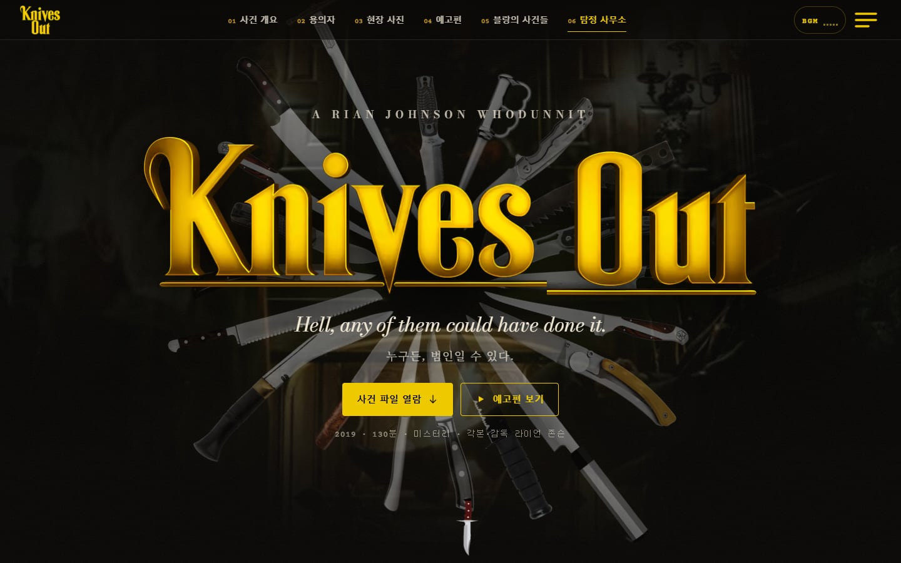

# KNIVES OUT — The Case File

**2020년 jQuery로 만든 원페이지 팬 사이트를, 2026년의 도구로 처음부터 다시 지었습니다.**

사건 파일을 열고, 칼이 찢은 포스터 너머의 보고서를 읽고, 돋보기로 용의자 열 명을 조사하는 「나이브스 아웃」(2019) 인터랙티브 팬 페이지


</div>

---

## Before → After

| | 2020 (원본) | 2026 (리마스터) |
|---|---|---|
| 스택 | HTML + jQuery 3.4 + FontAwesome JS·CSS(1.2 MB) | Astro 7 · TypeScript · GSAP · Lenis · Web Audio |
| 첫 로드 | **25.3 MB · 요청 49개**, 콘솔 오류 `num is not defined` | **LCP 전 0.22 MB**, 첫 화면 전체 0.9 MB, 오류 0 |
| 모바일 | "미디어쿼리x" — 햄버거는 X로 바뀌기만 하고 메뉴가 안 열림 | 전 구간 반응형, 터치용 레이아웃·스와이프 |
| 영상 | 예고편 MP4 4개(82 MB)를 저장소에 커밋, `<video>`로 직접 재생 | 공식 예고편은 YouTube(nocookie) 클릭 시 생성, 로컬본은 자막을 피한 2.39:1 무음 루프(840 KB)로 |
| 이미지 | 61장 45 MB, 갤러리 원본 20장을 썸네일로도 그대로 로드 | AVIF + WebP 반응형, 장면별 지연 로딩, AI 복원·업스케일 |
| 사운드 | 'OST'라며 자동재생(브라우저가 차단)하던 곡은 사실 라디오헤드의 「Knives Out」 | ElevenLabs로 만든 오리지널 테마·효과음 12종·저택 앰비언스, 실측 레벨 이퀄라이저 |
| 캐스트 정보 | 설명이 이미지에 박힌 픽셀, 조니를 "닉의 아내"로 오기 | 텍스트로 옮기고 바로잡음(닐), 스포일러 없는 '의심 포인트' |
| 접근성 | alt 없음, div 클릭, 키보드 불가, `maximum-scale=1` | 네이티브 버튼·dialog·포커스 관리·모션 줄이기 · **axe 위반 0** |
| Lighthouse (모바일 / 데스크톱) | — | **97 / 100** 성능 · 접근성·권장사항·SEO **100** |

<table>
  <tr>
    <td width="50%">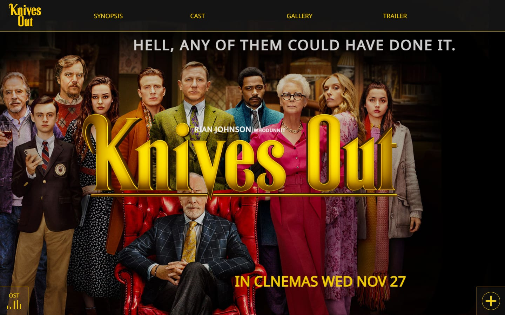<br><sub>2020 · 메인 — "IN CLNEMAS WED NOV 27"</sub></td>
    <td width="50%">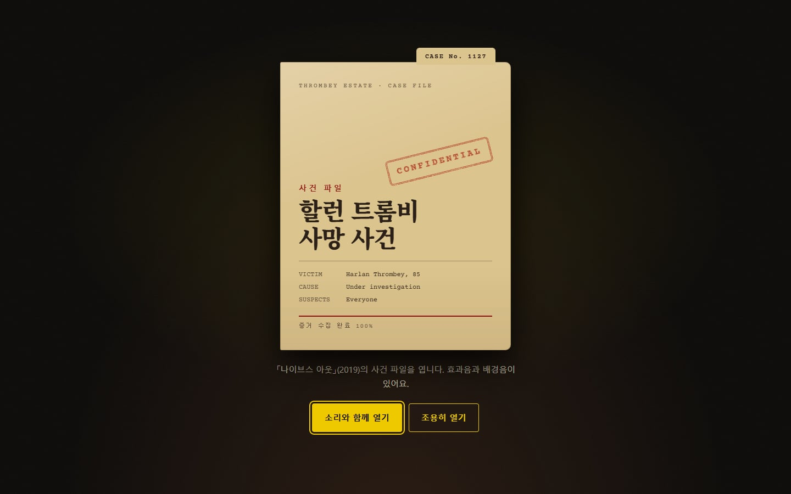<br><sub>2026 · 사건 파일 게이트 — 소리와 함께 / 조용히</sub></td>
  </tr>
  <tr>
    <td>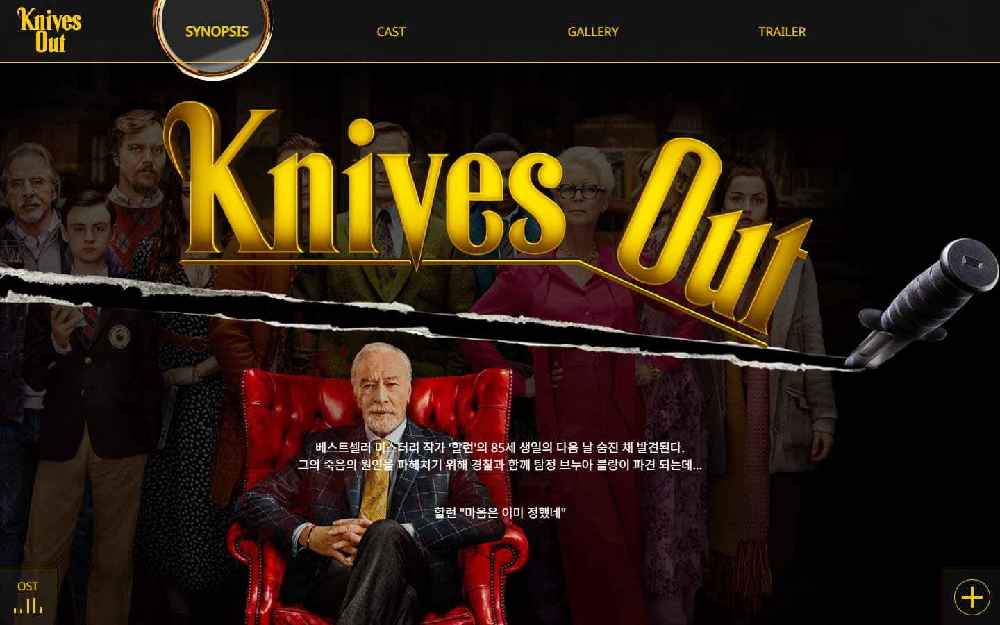<br><sub>2020 · 시놉시스 — 칼이 날아오고 피가 번지는 CSS 키프레임</sub></td>
    <td>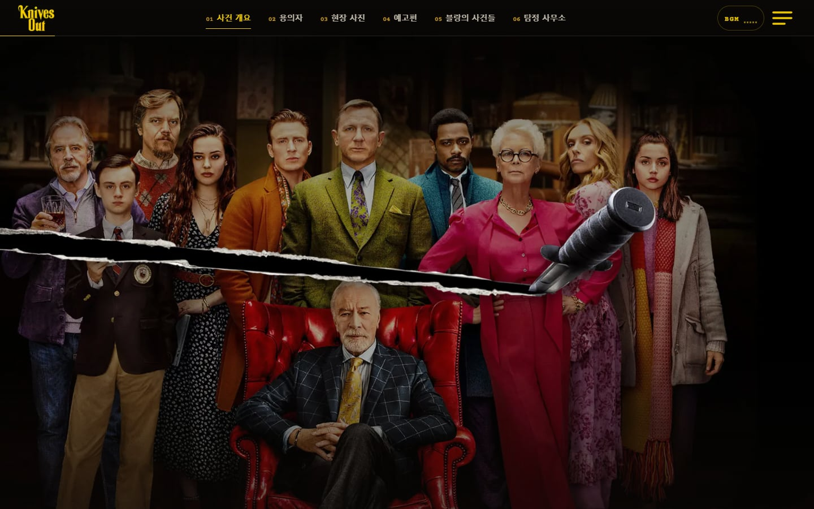<br><sub>2026 · 사건 개요 — 스크롤에 맞춰 칼이 포스터를 가르고, 갈라진 틈으로 보고서가 드러남</sub></td>
  </tr>
  <tr>
    <td>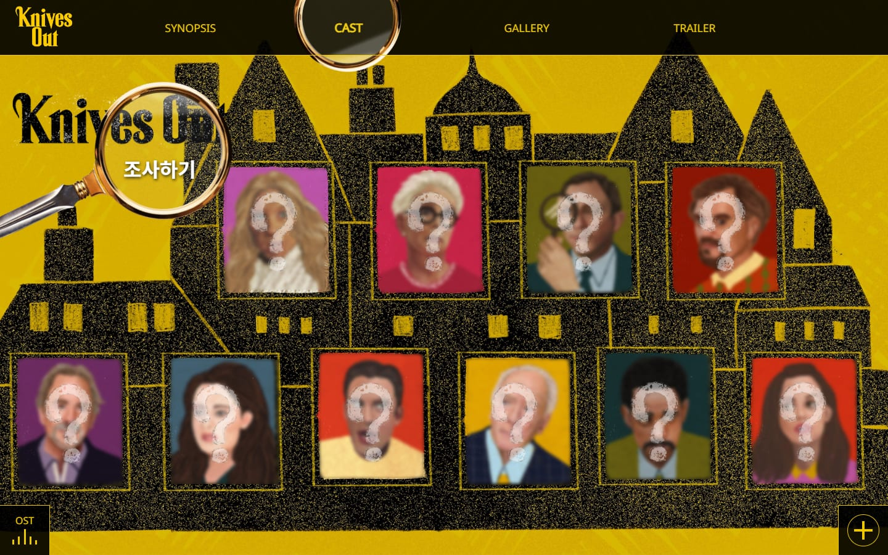<br><sub>2020 · 캐스트 — "조사하기"를 누르면 그림이 바뀜</sub></td>
    <td>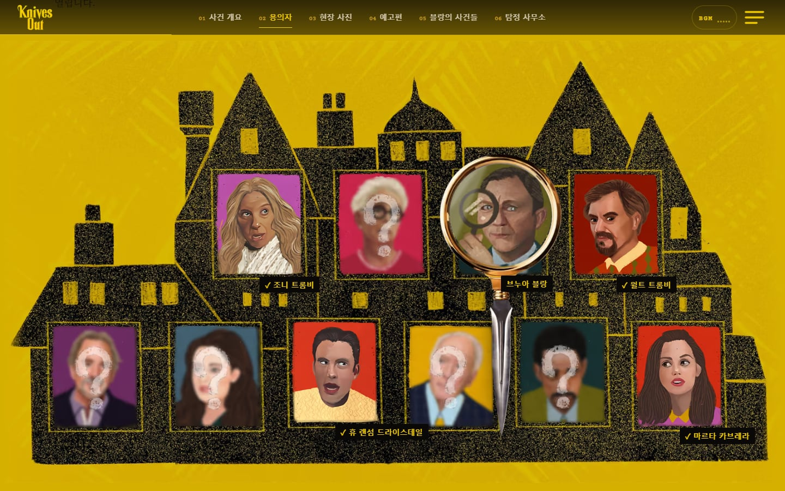<br><sub>2026 · 용의자 — 2020년의 칼 손잡이 돋보기가 커서가 되어 물음표 뒤 얼굴을 1.3배로 비춤</sub></td>
  </tr>
  <tr>
    <td>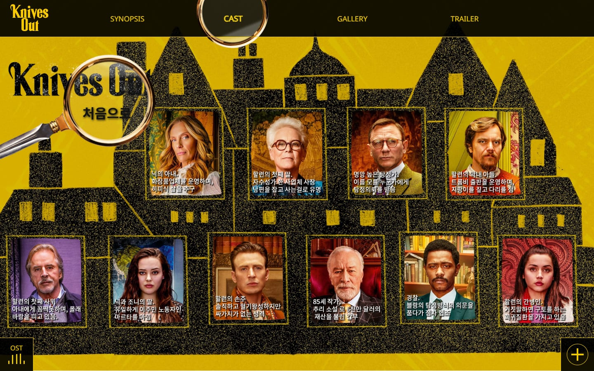<br><sub>2020 · 자세히 조사하기 — 설명이 이미지에 박혀 있음</sub></td>
    <td>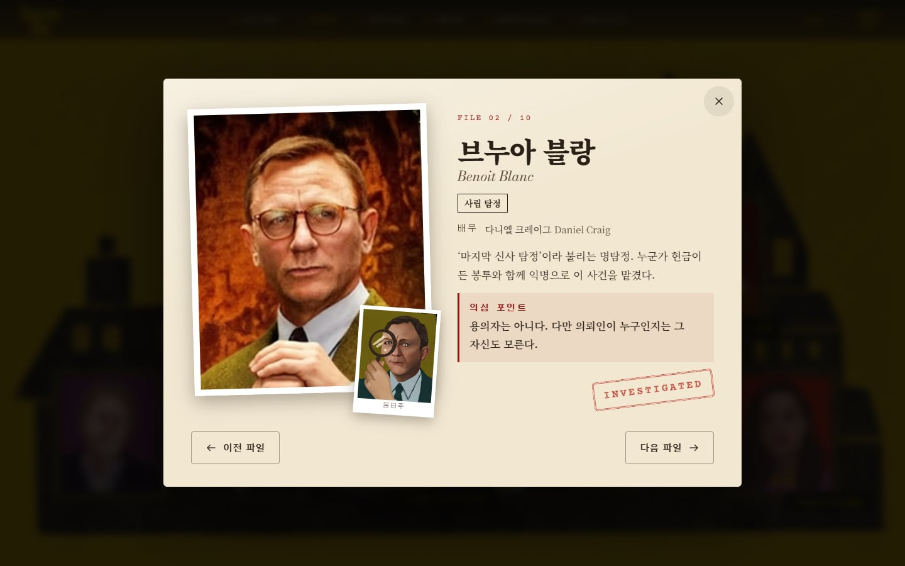<br><sub>2026 · 사건 파일 — AI로 글자를 지운 사진 + 몽타주 + 텍스트, ←/→로 넘김</sub></td>
  </tr>
  <tr>
    <td>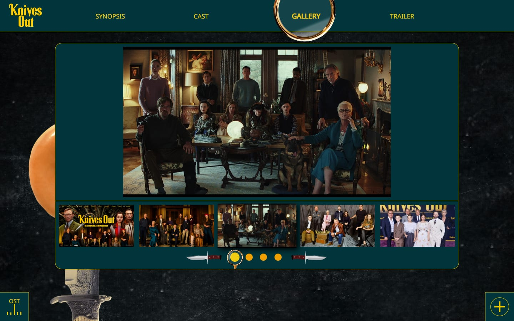<br><sub>2020 · 갤러리 — 1110px 고정 슬라이더</sub></td>
    <td>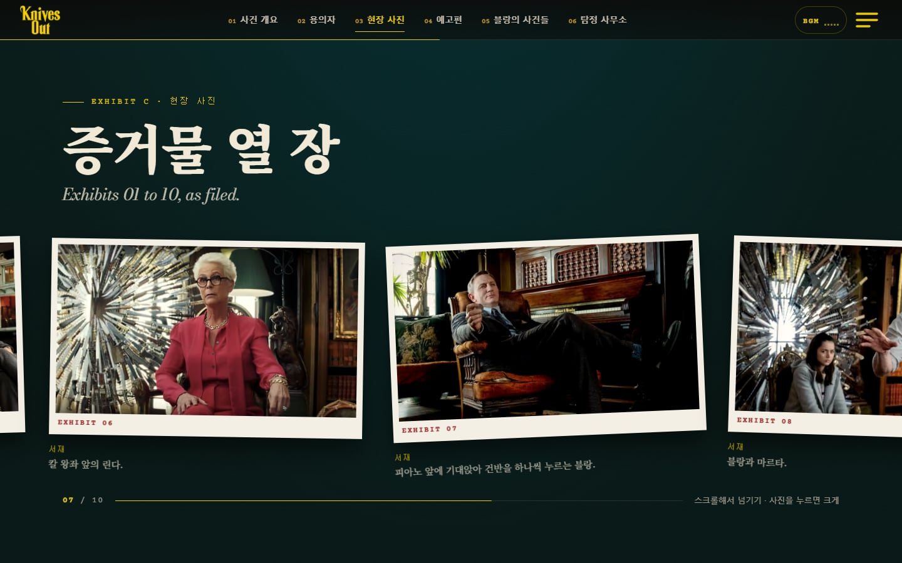<br><sub>2026 · 현장 사진 — 스크롤로 넘기는 증거물 10장(EXHIBIT 01–10)</sub></td>
  </tr>
  <tr>
    <td>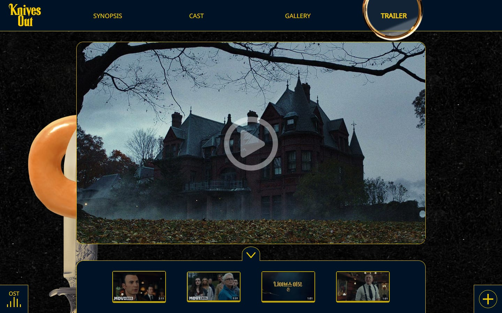<br><sub>2020 · 트레일러 — 32 MB MP4 직접 재생</sub></td>
    <td>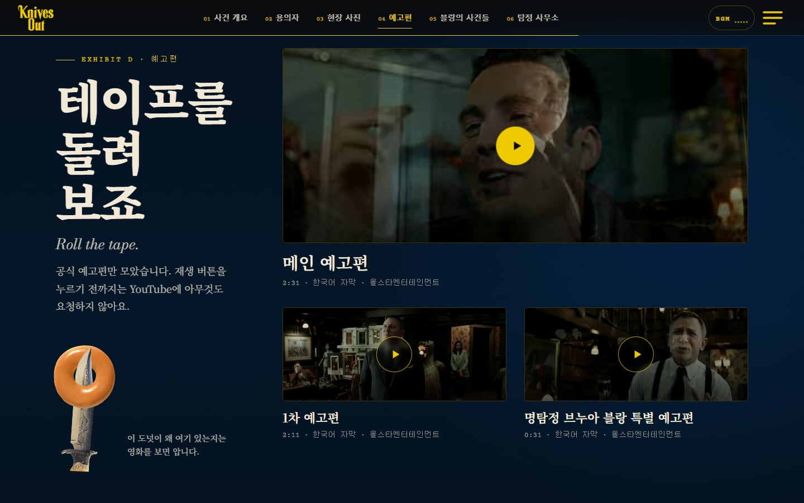<br><sub>2026 · 예고편 — 공식 영상만, 호버하면 무음 미리보기, 칼에 꽂힌 도넛은 그대로</sub></td>
  </tr>
</table>

<p align="center">
  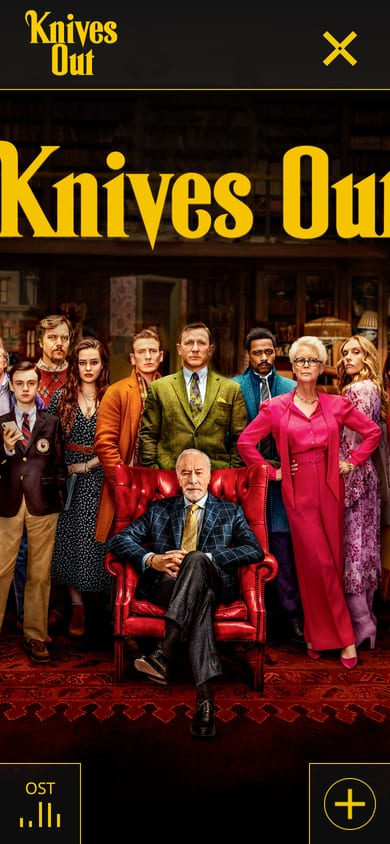
  &nbsp;
  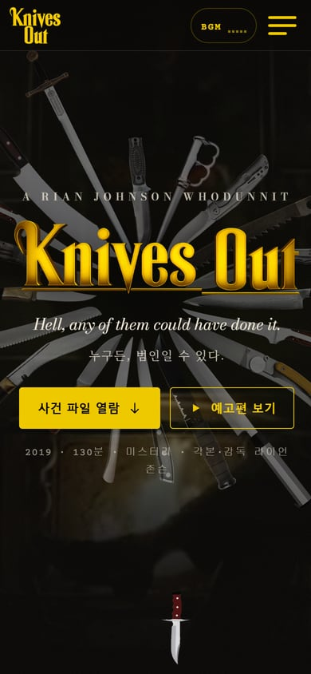
  &nbsp;
  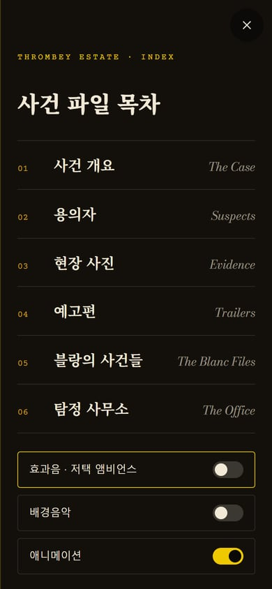
  &nbsp;
  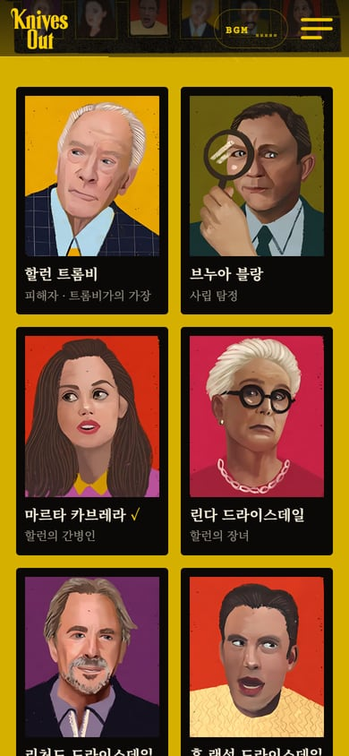
  <br><sub>왼쪽: 2020 모바일(햄버거를 눌러도 메뉴 없음) · 나머지: 2026</sub>
</p>

원본 코드는 [`legacy/`](legacy)에 그대로 보존했습니다. `npx serve legacy` 로 2020년 버전을 열어볼 수 있습니다.

---

## 무엇이 있나

| 섹션 | 내용 |
|---|---|
| **사건 파일 게이트** | 책상 위의 마닐라 서류철. *소리와 함께 / 조용히* 고르면 표지가 등을 축으로 넘어가며(앞면 → 안쪽의 증거 목록) 펼친 면이 화면 가운데로 오고, 첫 장 진술서 속으로 들어가며 히어로가 나타남 — 브라우저 오디오 잠금을 푸는 사용자 제스처이자, 무거운 것을 미뤄 두는 대기실. 페이지 렌더링과 스크롤 연출 준비를 먼저 끝낸 뒤 표지를 넘겨서, 넘김이 끊기지 않음 |
| **히어로** | 2020년 인트로(6배로 커진 칼 바퀴가 로고로 모여듦)를 GSAP으로 재연출. 예고편에서 자막 없는 장면만 골라 만든 11.5초 루프, 호버하면 "Out"이 기울어짐 |
| **사건 개요** | 섹션이 고정되고, 스크롤에 맞춰 칼이 포스터를 가르고, 찢어진 두 조각이 벌어지며 보고서가 드러나고, 문장이 한 단어씩 밝아짐 → 피, 사건 기록, 예고편 대사 |
| **용의자** | 저택 포스터 위를 돋보기가 따라다니며 흐린 얼굴을 비춤. 창문을 열면 사건 파일(사진·몽타주·배우·의심 포인트), 조사한 얼굴은 남고 진행도는 저장됨, 10명 완료 시 도장 |
| **현장 사진** | 증거물 10장. 데스크톱은 페이지 스크롤이 증거물 스트립을 옆으로 넘기고(스크롤의 1.8배 속도라 약 2.5화면이면 끝까지), 터치는 네이티브 스와이프. 아래 카운터(`03 / 10`)와 진행선이 남은 분량을 보여 줌. 라이트박스는 2020년의 칼 화살표 버튼 + ←/→ + 스와이프, 앞뒤 사진은 미리 받아 둠 |
| **예고편** | 올스타엔터테인먼트·Lionsgate 공식 업로드만(oEmbed로 확인). 카드는 호버 시 무음 미리보기, 재생은 dialog 안의 youtube-nocookie iframe(열 때 생성, 닫으면 제거) |
| **블랑의 사건들** | 「나이브스 아웃」(2019) → 「글래스 어니언」(2022) → 「웨이크 업 데드 맨」(2025) 세 권의 파일 · 세 제목 모두 노래 제목이라는 사실과, 2020년 'OST'의 정체 |
| **탐정 사무소 (AI)** | 일상의 미스터리를 의뢰하면 Gemini가 연기하는 블랑이 사건명·용의자·결정적 단서·추리·결론을 구조화된 보고서로 타이핑하고 도장을 찍음 |
| **감상 정보** | 스트리밍 목록은 자주 바뀌므로 JustWatch로 연결, 크레딧·수상 후보 |

**소리도 사건의 일부입니다.** 입장할 때 괘종시계가 한 번 울리고, 칼 바퀴가 돌 때 칼날 소리, 칼이 포스터에 꽂힐 때 둔탁한 소리, 사진을 열면 셔터, 보고서에는 타자기와 도장. 배경에는 벽난로·괘종시계·빗소리가 깔린 저택 앰비언스. HUD의 BGM 버튼은 2020년의 'OST' 이퀄라이저를 이었지만, 이번에는 막대가 실제 오디오 레벨로 움직입니다.

<table>
  <tr>
    <td width="50%">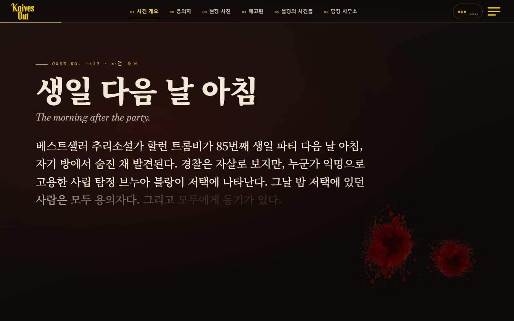</td>
    <td width="50%">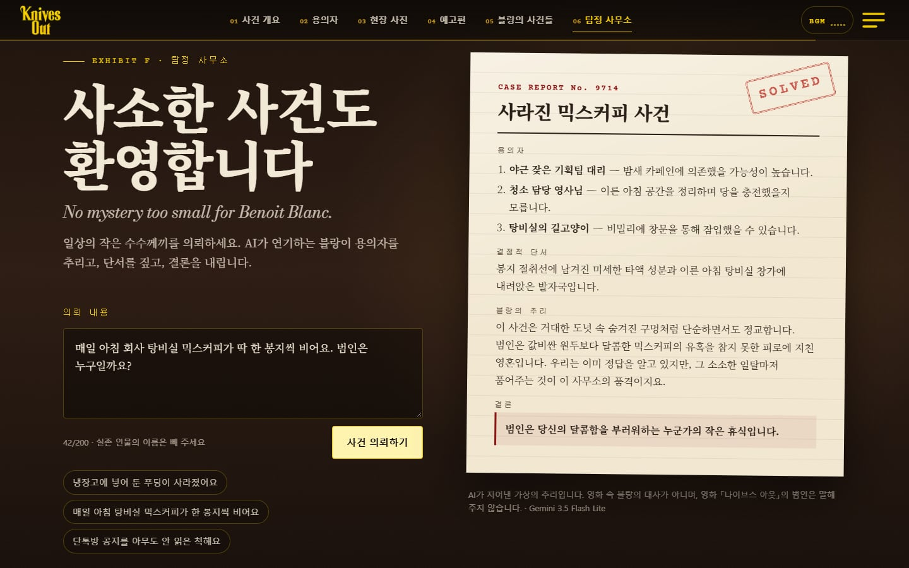</td>
  </tr>
  <tr>
    <td>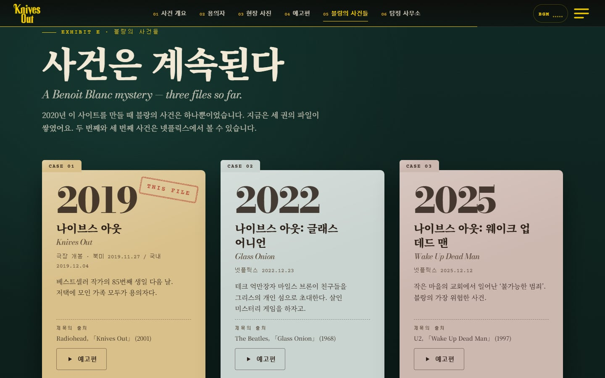</td>
    <td>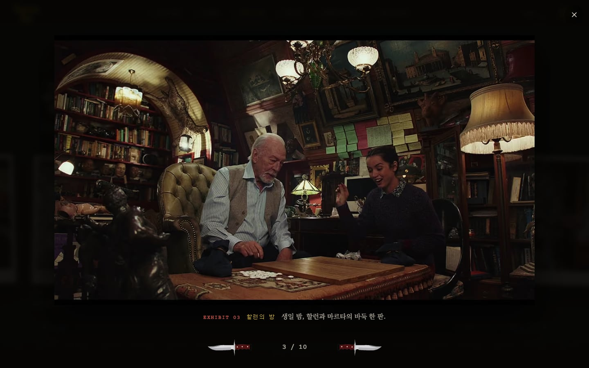</td>
  </tr>
</table>

---

## AI · 미디어 파이프라인

에셋은 손으로 만지지 않고, 다시 돌릴 수 있는 스크립트로 만들었습니다.

| 스크립트 | 도구 | 하는 일 |
|---|---|---|
| `scripts/images.mjs` | sharp | `11.png`, `5zMiji6nLQPW0N6rocXYVbQuJXo.jpg` 같은 레거시 이미지 61장을 의미 있는 이름으로 정리, 투명 여백 자르기, 저택 포스터의 창문 10개 좌표를 기록하고 그림·사진 초상을 잘라냄 |
| `scripts/upscale.mjs` | **fal.ai** nano-banana · Real-ESRGAN | 2020년 캐릭터 사진에 **박혀 있던 한글 설명을 AI로 지우고** 아래를 복원(205 px → 800 px). 모델이 구도를 바꾼 장은 원래 구도로 다시 잘라 ESRGAN으로 디테일 복원. 그림 초상 ×4, 로고·도넛은 색과 알파를 따로 업스케일 |
| `scripts/sfx.mjs` | **ElevenLabs** Sound Generation + Music | 효과음 12종과 22초 저택 앰비언스(끝을 앞에 크로스페이드한 무한 루프), 120초 오리지널 테마(현악 피치카토·하프시코드) → FFmpeg 라우드니스 정규화. `--review`를 붙이면 **Gemini가 곡을 듣고** 악기·분위기·잡음·적합도를 보고 |
| `scripts/media.mjs` | FFmpeg | 예고편 → CFR 중간본(프레임 정확도) → 번인 자막이 시작되는 y=572 위쪽만 남긴 2.39:1 크롭 → 크로스페이드 히어로 루프(VP9 840 KB / H.264, 모바일판), 예고편 카드별 무음 미리보기와 포스터 |
| `scripts/fonts.mjs` | Google Fonts `text=` 서브셋 | 게이트 제목 9글자 전용 폰트(42 KB, 프리로드)와, **이 페이지 소스에 실제로 쓰인 한글만** 담은 가변 굵기 폰트 한 파일(151 KB) |
| `scripts/og.mjs` | sharp | 소셜 카드(1200×630, 칼 왕좌 + 로고)와 단검 아이콘 |
| `scripts/shots-legacy.mjs` · `shots.mjs` | puppeteer-core | 이 README의 Before/After 스크린샷과 2020년 페이지 무게 측정 |
| `scripts/a11y.mjs` | axe-core | 게이트를 열고 모든 섹션을 스크롤한 뒤 페이지와 대화상자 3종을 데스크톱·모바일로 검사 |
| `src/pages/api/blanc.ts` | **Gemini 3.5 Flash Lite** | 탐정 사무소 엔드포인트(Vercel Function). JSON 스키마로 구조화된 보고서, 키는 서버에만, Origin 검사 · IP당 레이트 리밋 · 18초 타임아웃 · 실존 인물 실명 금지 · 영화 범인 스포일러 거절 · 키가 없으면 "출장 중" 안내 |

---

## 성능 · 접근성

Lighthouse 13.6, gzip으로 서빙한 정적 빌드(`npx serve .vercel/output/static`) 기준입니다.

| | 성능 | 접근성 | 권장사항 | SEO | LCP | TBT | CLS |
|---|---|---|---|---|---|---|---|
| 모바일 · 첫 방문 | **97** | **100** | **100** | **100** | 2.6 s | 0 ms | 0 |
| 데스크톱 · 첫 방문 | **100** | **100** | **100** | **100** | 0.6 s | 0 ms | 0 |
| 데스크톱 · 전체 페이지 (`/?enter`) | **98** | **100** | **100** | **100** | 1.0 s | 0 ms | 0 |
| 모바일 · 전체 페이지 (`/?enter`) | 78 | **100** | **100** | **100** | 5.2 s | 130 ms | 0.08 |

Lighthouse는 첫 화면만 봅니다. 그래서 [`scripts/a11y.mjs`](scripts/a11y.mjs)로 게이트를 열고 끝까지 스크롤한 상태의 **전체 페이지와 대화상자 3종(메뉴·사건 파일·라이트박스)을 axe-core로 따로 검사했고, 데스크톱·모바일 모두 WCAG 2.2 AA 위반 0건**입니다.

**한글 웹폰트가 성능의 전부였습니다.** 처음 측정한 모바일 성능은 69(LCP 8.6초)였습니다. 원인은 게이트 뒤에서 페이지 전체가 렌더링되며 Noto Serif KR의 유니코드 조각 25개(약 900 KB)를 첫 화면 전에 요청하고 있었습니다.
1. 게이트가 닫혀 있는 동안 히어로 아래는 렌더링하지 않음(`display: none` / `content-visibility`). 스크롤 연출은 입장 후에 측정.
2. LCP 요소인 게이트 제목은 9글자 서브셋(42 KB) 하나로, 화면에 안 보이는 스크린리더 텍스트는 시스템 폰트로.
3. 히어로 폰트·이미지·영상은 로드 1.5초 뒤, 또는 손이 서류철에 닿는 순간(pointerover·keydown) 미리 받음.
4. 페이지 전체 한글은 소스에서 뽑은 488자 서브셋 한 파일로. 빠진 글자(예: AI 답변)는 같은 폰트의 조각으로 글자 단위 대체.

→ 모바일 성능 **69 → 97**, LCP 전 전송량 473 KB → 224 KB, 페이지 전체 폰트 요청 24개 → 7개.

---

## 구조

```
src/
├─ pages/
│  ├─ index.astro          # 섹션 조립
│  └─ api/blanc.ts         # Gemini 탐정 사무소 (on-demand, 나머지는 전부 정적)
├─ components/             # Gate · Hud · Hero · CaseFile · Suspects · Evidence · Trailers
│                          # Series · Office · Credits · Footer · VideoDialog · Icon
├─ scripts/
│  ├─ app.ts               # 진입점 — 무거운 모듈은 idle/입장 시 동적 import
│  ├─ gate.ts              # 서류철 게이트, 폰트·히어로 예열
│  ├─ motion.ts            # GSAP 연출 (인트로 · 칼과 찢어진 포스터 · 증거물 스트립) — gsap.context로 되돌릴 수 있음
│  ├─ suspects.ts          # 돋보기 렌즈(clip-path + 확대) · 사건 파일 · 진행도
│  ├─ audio.ts             # Web Audio 엔진 (효과음 · 앰비언스 · BGM 분석기)
│  ├─ office.ts / evidence.ts / dialogs.ts / hud.ts / media.ts / scroll.ts / prefs.ts
├─ data/                   # 용의자 · 증거물 · 예고편 · 시리즈 · 크레딧 — 콘텐츠는 데이터로
└─ styles/global.css       # 디자인 토큰 · 서브셋 폰트 · 도장 · dialog · 리빌 · 페일세이프
scripts/                   # 위 에셋 파이프라인과 검증 스크립트
legacy/                    # 2020년 원본 그대로
```

**설계 메모**

- 페이지는 정적 HTML이고 상호작용은 점진적 향상입니다. JS가 없으면 게이트가 숨고 모든 콘텐츠가 보입니다. 앱 스크립트가 실패해도 9초 뒤 CSS 페일세이프와 인라인 타이머가 서류철을 엽니다.
- `prefers-reduced-motion`(또는 메뉴의 *애니메이션* 스위치)이면 Lenis·핀·분할·영상이 꺼지고 정적 레이아웃이 됩니다. 스위치를 켜고 끄면 GSAP context를 통째로 되돌리거나 다시 세웁니다. 저데이터(`saveData`/2G)에서는 영상 대신 포스터를 씁니다.
- 색은 2020년의 골드 `#efc900`과 틸 `#01353b`를 계승하고, 저택 포스터의 노랑 `#d6b001`은 원본에서 샘플링해 포스터가 섹션 배경과 이음새 없이 이어지게 했습니다.
- 용의자 진행도는 `localStorage`에 저장되고, 블랑의 추리는 스포일러를 말하지 않도록 프롬프트와 스키마로 묶었습니다.
- `/?enter`는 게이트를 건너뜁니다(공유 링크, 재방문, 검사용). `#suspects` 같은 해시는 핀이 자리 잡은 뒤에 이동합니다.

---

## 시작하기

```bash
npm install
cp .env.example .env.local   # GEMINI_API_KEY (선택)
npm run dev                  # http://localhost:4321
```

| 명령 | |
|---|---|
| `npm run dev` | 개발 서버 |
| `npm run build` | `.vercel/output` 생성 (정적 페이지 + 탐정 사무소 함수) |
| `npm run preview` | 빌드 결과를 정적으로 띄워 보기(탐정 사무소 API 제외) |
| `npm run check` | 타입 검사 |
| `npm run assets` → `npm run assets:upscale` | 레거시 원본에서 영상·이미지 재생성 (순서 중요: images가 AI 복원본을 덮어씀) |
| `npm run assets:sfx` | ElevenLabs로 효과음·앰비언스·테마 재생성 (`ELEVENLABS_API_KEY`, `--review`는 `GEMINI_API_KEY`도) |
| `npm run assets:fonts` | 문구를 바꾼 뒤 한글 서브셋 폰트 재생성 |
| `npm run shots` · `npm run a11y` | README 스크린샷 · 전체 페이지 접근성 검사 (빌드를 4401 포트로 서빙한 상태에서) |

### 배포

Astro + `@astrojs/vercel`입니다. 프로젝트를 연결하고 환경 변수 `GEMINI_API_KEY`만 넣으면 탐정 사무소가 문을 엽니다. 키가 없어도 페이지는 완전히 동작합니다. `vercel.json`이 미디어 캐시와 보안 헤더를 설정합니다.

> 지금 GitHub Pages는 `master` 루트의 2020년판을 서비스하고 있습니다. 이 브랜치를 `master`에 합치면 루트에 `index.html`이 없어지므로, Pages는 끄고 Vercel로 옮기는 것을 권장합니다.

---

## 2020 → 2026, 고친 것들

- **모바일**: 960px 이하에서 메뉴가 사라지고 햄버거는 아이콘만 바뀌어 다른 장면으로 갈 방법이 없었음. 1100·1130·1000px 고정폭, `maximum-scale=1`로 확대 금지.
- **버그**: 썸네일 클릭마다 `num is not defined` 예외, 점과 리스트로 따로 노는 슬라이더 상태 두 벌, `mousemove`마다 리사이즈, 스크롤되지 않는 화면의 스크롤 감지(죽은 코드), 자동재생이 막혔는데 'OST 재생 중'으로 보이던 버튼, 쓰지 않는 로컬 jQuery 3.1.1과 CDN 3.4.1 이중 로드.
- **콘텐츠**: `IN CLNEMAS` 오타와 지난 개봉 정보, 조니를 "닉의 아내"·메그를 "닉과 조니의 딸"로 쓴 오기(닐), 'OST'로 소개된 라디오헤드 곡, 시놉시스 문장. 캐스트 설명은 이미지에서 텍스트로 옮겼습니다.
- **에셋**: 예고편 MP4 82 MB와 PSD 7.8 MB가 커밋된 267 MB 저장소, 썸네일 자리에 원본 20장을 로드하던 갤러리, 아이콘 4개를 위한 1.2 MB FontAwesome. 썸네일에 찍혀 있던 제3자 채널 워터마크도 공식 업로드로 대체했습니다.

---

## 저작권

「나이브스 아웃」 시리즈와 이 프로젝트에 쓰인 영화 이미지·포스터 아트·예고편의 권리는 Lionsgate, MRC, T-Street, Netflix 및 각 권리자에게 있습니다. 이 저장소는 제작사와 관계없는 **비영리 팬 프로젝트**입니다. 효과음·앰비언스·배경음악(ElevenLabs 생성)과 코드는 이 프로젝트의 산출물입니다. 2020년판이 'OST'로 쓰던 라디오헤드의 「Knives Out」은 리마스터에서 사용하지 않으며, `legacy/`에만 원본 그대로 남아 있습니다.
